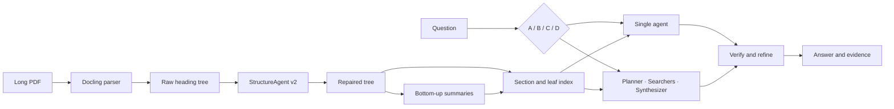
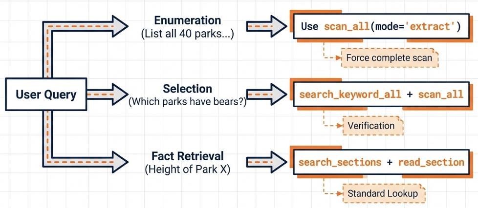
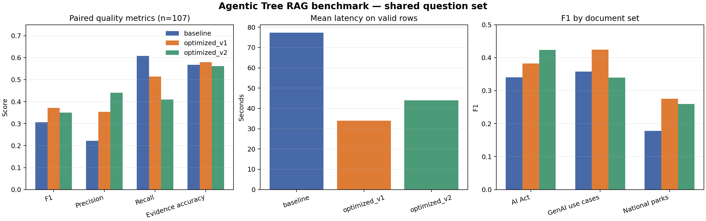

# Agentic Tree RAG

Structure-aware retrieval for long-document question answering.

> **Best Project Team** · AICOSS–THU Global Student Program · 2026 Capstone Project

**[한국어 README](README.md)**

Standard vector RAG is good at finding a few relevant passages, but it is less reliable when a question requires complete coverage—such as listing every item or sorting all entries by an attribute. Agentic Tree RAG represents a document as a hierarchy, repairs malformed section structure, summarizes it bottom-up, and selects retrieval tools according to the question type. It searches narrowly for a single fact and uses exhaustive traversal and verification for enumeration and selection questions.

## System overview



The complete capstone pipeline is available in [`notebooks/capstone_pipeline.ipynb`](notebooks/capstone_pipeline.ipynb). Its implementation includes:

- Docling-based PDF parsing and Markdown hierarchy construction
- LLM-guided `StructureAgent v2` with repeated-boundary detection and container flattening
- bottom-up concurrent summaries
- section and leaf indexing in ChromaDB
- ten retrieval and traversal tools
- single-agent, multi-agent, and adaptive query paths
- completeness verification and follow-up retrieval
- token F1, evidence accuracy, latency, and LLM-judge evaluation

See [architecture.md](docs/architecture.md) for the component-level design and [development.md](docs/development.md) for the progression from flat RAG to StructureAgent v2.

## Query-dependent retrieval



| Question type | Example | Main path |
|---|---|---|
| Single fact | “What is the fine in Article 5?” | Section/content search → read section |
| Enumeration | “List every park and its highest point.” | All entries → exhaustive extraction → sort |
| Selection | “Which parks mention bears?” | Keyword scan → full verification scan |
| Cross-section | “Compare rules across titles.” | Plan subquestions → parallel evidence search → synthesis |

The ten tools range from local lookup (`search_sections`, `read_section`) to exhaustive traversal (`get_all_entries`, `extract_from_all`, `scan_all`). Exhaustive traversal helps avoid omissions that top-k retrieval can cause.

## Benchmark

The three recorded configurations have different raw row counts. The table below uses only the 107 questions shared by all three runs.

| Run | F1 | Precision | Recall | Evidence accuracy | Mean latency |
|---|---:|---:|---:|---:|---:|
| Baseline | 0.306 | 0.222 | **0.609** | 0.567 | 77.4 s |
| Optimized v1 | **0.371** | 0.354 | 0.514 | **0.579** | **33.9 s** |
| Optimized v2 | 0.351 | **0.440** | 0.409 | 0.562 | 44.0 s |



Optimized v1 records the best overall F1 and latency. Optimized v2 favors precision and performs best on the AI Act subset. The national-parks set remains challenging because its questions require exhaustive coverage. Full dataset-level results, valid sample counts, and comparison scope are documented in [experiments.md](docs/experiments.md).

## Repository structure

```text
.
├── assets/                       # Routing and benchmark figures
├── benchmarks/
│   ├── questions/                # Three QA specifications
│   └── results/
│       ├── raw/                  # Baseline and two optimized runs
│       └── paired_*              # Recalculated shared-question reports
├── docs/
│   ├── architecture.md
│   ├── development.md
│   └── experiments.md
├── notebooks/capstone_pipeline.ipynb
├── src/agentic_tree_rag/         # Tested tree and benchmark core
├── tests/
└── tools/build_benchmark_report.py
```

## Reproduce the benchmark analysis

The report generator does not call an LLM or require the source PDFs.

```bash
python -m venv .venv
source .venv/bin/activate          # Windows: .venv\\Scripts\\activate
pip install -e ".[dev]"
python -m unittest discover -s tests
python tools/build_benchmark_report.py
```

## Run the full capstone notebook

```bash
pip install -r requirements-capstone.txt
cp .env.example .env
```

Set `MISTRAL_API_KEY` and, when using the recorded judge path, `GEMINI_API_KEY`. Provide the three source documents locally as described in [benchmarks/README.md](benchmarks/README.md), then run the notebook.

The THU/DASU hierarchical Docling postprocessor used by the original parser must be installed from its authorized source. Without it, replace the parser portion with standard Docling Markdown output and apply the StructureAgent to that structure.

## Scope

- The repository includes the complete capstone notebook, paired benchmark data, and reusable deterministic utilities.
- Third-party PDFs, model caches, ChromaDB indexes, virtual environments, and API credentials are not included.
- `optimized_v1` and `optimized_v2` identify complete recorded runs; they are not one-variable causal ablations.
- Some raw rows ended with runtime errors. Reports retain the valid sample count for every metric.

## License

Repository-authored code and documentation are available under the [MIT License](LICENSE). Source documents, models, Docling extensions, and provider SDKs retain their respective licenses.
