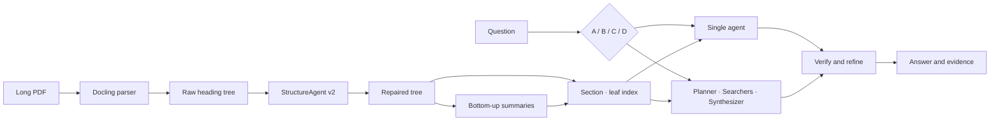
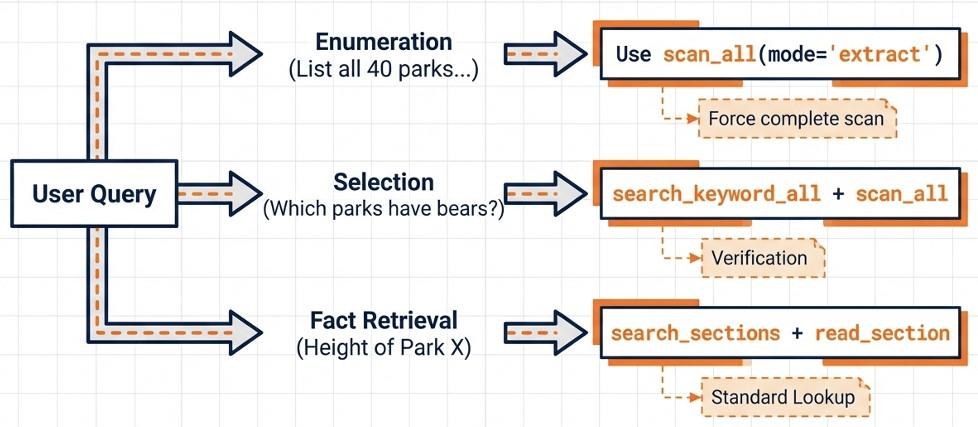
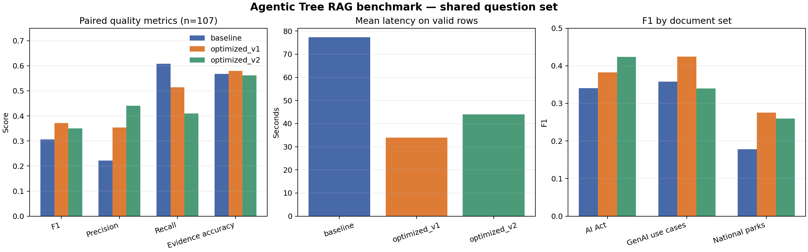

# Agentic Tree RAG

긴 문서의 전체 구조를 활용하는 Agentic Document QA 시스템

> AICOSS–THU 글로벌 학생 프로그램 · 2026 Capstone Project

[English README](README.md)

일반적인 vector RAG는 질문과 가까운 몇 개의 청크를 찾는 데 적합하다. 반면 “문서에 있는 항목을 전부 나열하라”, “모든 항목을 특정 속성으로 정렬하라”, “멀리 떨어진 절의 내용을 연결하라” 같은 질문에서는 일부 결과만 가져오고도 답을 완성한 것처럼 보이기 쉽다.

Agentic Tree RAG는 문서를 계층 구조로 만들고, 잘못 파싱된 section 관계를 복구한 뒤, 질문 유형에 따라 검색 방식을 바꾼다. 단일 사실은 좁게 검색하고, 열거형 질문은 문서 단위를 끝까지 순회한다.

## 전체 구조



전체 구현은 [`notebooks/capstone_pipeline.ipynb`](notebooks/capstone_pipeline.ipynb)에 있다.

- Docling 기반 PDF 파싱과 Markdown 계층 구성
- 반복 경계 감지와 container flattening을 사용하는 `StructureAgent v2`
- bottom-up 병렬 요약
- ChromaDB section/leaf 인덱스
- 검색·순회 도구 10개
- single-agent, multi-agent, adaptive routing
- 답변 완전성 검증과 추가 검색
- token F1, evidence accuracy, latency, LLM judge 평가

구성 요소별 설명은 [architecture.md](docs/architecture.md), flat RAG에서 StructureAgent v2까지의 개발 과정은 [development.md](docs/development.md)에 정리했다.

## 질문 유형별 검색



| 질문 | 예시 | 검색 방식 |
|---|---|---|
| 단일 사실 | “Article 5의 벌금은 얼마인가?” | section/content 검색 후 원문 확인 |
| 전체 열거 | “모든 공원과 최고봉을 나열하라.” | 전체 entry 순회, 속성 추출, 정렬 |
| 조건 선택 | “곰이 언급된 공원은?” | 키워드 전체 검색 후 누락 검증 |
| 교차 추론 | “여러 title의 규칙을 비교하라.” | 하위 질문 계획, evidence 검색, 종합 |

`search_sections`, `read_section` 같은 국소 검색과 `get_all_entries`, `extract_from_all`, `scan_all` 같은 전체 순회 도구를 구분한 것이 핵심이다.

## 벤치마크

세 실행 결과에 공통으로 존재하는 107개 문항만 같은 조건으로 다시 집계했다.

| Run | F1 | Precision | Recall | Evidence accuracy | 평균 latency |
|---|---:|---:|---:|---:|---:|
| Baseline | 0.306 | 0.222 | **0.609** | 0.567 | 77.4초 |
| Optimized v1 | **0.371** | 0.354 | 0.514 | **0.579** | **33.9초** |
| Optimized v2 | 0.351 | **0.440** | 0.409 | 0.562 | 44.0초 |



Optimized v1은 전체 F1과 latency가 가장 좋다. Optimized v2는 precision이 가장 높고 AI Act 문서군에서 가장 좋은 F1을 기록했다. 모든 항목을 빠짐없이 찾아야 하는 national parks 문서군은 세 설정 모두에서 가장 어려웠다.

문서별 결과와 유효 표본 수는 [experiments.md](docs/experiments.md)에서 확인할 수 있다.

## 저장소 구성

```text
.
├── assets/                       # 검색 구조와 벤치마크 그래프
├── benchmarks/
│   ├── questions/                # QA 세트 3종
│   └── results/
│       ├── raw/                  # 원본 실행 결과 3종
│       └── paired_*              # 공통 문항 재집계 결과
├── docs/
├── notebooks/capstone_pipeline.ipynb
├── src/agentic_tree_rag/         # 문서 트리와 평가 핵심 코드
├── tests/
└── tools/build_benchmark_report.py
```

## 벤치마크 재생성

이 과정은 LLM이나 원본 PDF를 사용하지 않는다.

```bash
python -m venv .venv
.venv\Scripts\activate
pip install -e ".[dev]"
python -m unittest discover -s tests
python tools/build_benchmark_report.py
```

## 전체 노트북 실행

```bash
pip install -r requirements-capstone.txt
```

`.env.example`을 참고해 `MISTRAL_API_KEY`와 평가용 `GEMINI_API_KEY`를 환경변수로 설정한다. 원본 문서 3종은 [benchmarks/README.md](benchmarks/README.md)의 파일명에 맞춰 로컬에 배치한다.

기존 파서에서 사용한 THU/DASU hierarchical Docling postprocessor는 허가된 배포 경로를 통해 별도로 설치해야 한다. 이를 사용할 수 없다면 표준 Docling Markdown 출력을 StructureAgent 입력으로 연결해야 한다.

## 포함 범위

- 전체 캡스톤 노트북, 107개 공통 문항 평가, 재사용 가능한 deterministic core를 포함한다.
- 제3자 PDF, 모델 캐시, ChromaDB/FAISS 인덱스, 가상환경, API 키는 포함하지 않는다.
- `optimized_v1`, `optimized_v2`는 각 실행 설정의 이름이며 단일 변수의 인과관계를 의미하지 않는다.
- 실행 오류가 있었던 행은 지표별 유효 표본 수에서 제외한다.

## License

저장소에서 작성한 코드와 문서는 [MIT License](LICENSE)를 따른다. 원본 문서, 외부 모델과 라이브러리는 각 라이선스를 따른다.
