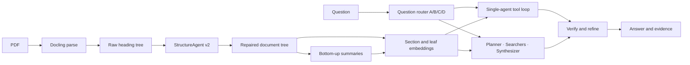
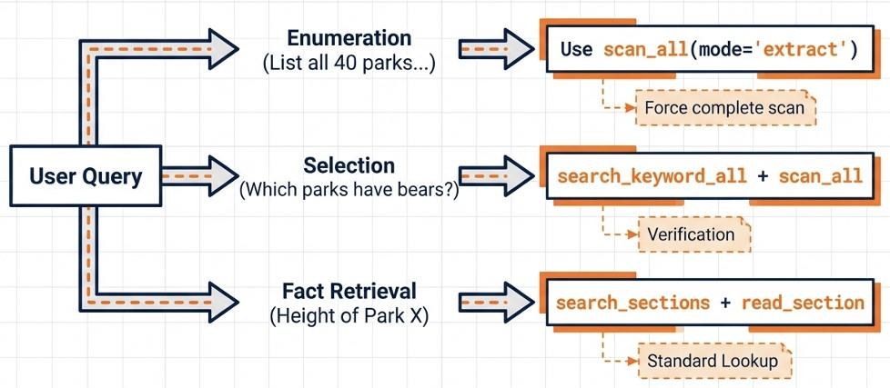

# Architecture

## Design target

Vector RAG works well for local fact lookup but often misses exhaustive questions such as “list every item in the document.” Similarity search returns the most relevant chunks, not a guarantee of document-wide coverage. This project adds a document tree and query-dependent traversal so that retrieval can switch between lookup, enumeration, comparison, and cross-section reasoning.

## 1. Parsing and structural repair

The capstone notebook converts PDFs to Markdown with Docling and the hierarchical PDF postprocessor used during the THU/DASU program. Markdown headings become section nodes; paragraphs become leaves.

PDF extraction does not always preserve heading levels. A repeated record layout can arrive as hundreds of sibling sections instead of one parent node per record. `StructureAgent` handles this in two steps:

1. `analyze()` sends a digest of headings to the LLM and requests a JSON restructuring plan.
2. `restructure()` applies the plan, using repeated boundary signals, majority voting, and container-node flattening to group related sections.

Small text leaves are merged before summarization. The result is a tree whose top-level children represent the main document units—for example, one node per national park.

## 2. Bottom-up summaries and index

Leaves retain source text. Parent summaries are produced bottom-up so that a higher node represents all descendants rather than an arbitrary fixed-size chunk. Summaries at the same level are processed concurrently.

The notebook indexes both section summaries and leaf content in ChromaDB with `sentence-transformers/all-MiniLM-L6-v2`. This supports broad section discovery and narrow evidence lookup without discarding the hierarchy.

## 3. Retrieval tools

The agent has ten tools:

| Tool | Purpose |
|---|---|
| `get_overview` | Display the document and its main units |
| `search_sections` | Search section summaries |
| `read_section` | Read a selected subtree |
| `search_content` | Search leaf content |
| `list_children` | Traverse one tree level |
| `find_all` | Find repeated structural items |
| `search_keyword_all` | Scan all units for keyword variants |
| `get_all_entries` | Enumerate every top-level unit |
| `extract_from_all` | Apply deterministic extraction across units |
| `scan_all` | Run exhaustive per-section extraction for list questions |

The explicit exhaustive tools are the main difference from top-k-only RAG.

## 4. Query routing

Questions are classified into four types:

| Type | Question shape | Route |
|---|---|---|
| A | Single fact | Single agent and local section/content search |
| B | List or count | Full structure traversal and exhaustive scan |
| C | Summary or comparison | Multiple relevant sections and synthesis |
| D | Facts connected across distant sections | Planner, search workers, and synthesis |

The multi-agent path contains a planner, focused search workers, and a synthesizer. Type B tasks also receive the document structure and all top-level units to reduce early stopping.

## 5. Verification

The answer is checked for coverage, exact numeric values, ordering, and missing entries. If verification fails, the verifier proposes follow-up queries and another tool pass. This is especially important for enumeration, where a fluent partial answer can otherwise look complete.

## Code map

The complete capstone implementation is in [`notebooks/capstone_pipeline.ipynb`](../notebooks/capstone_pipeline.ipynb):

| Notebook section | Implementation |
|---|---|
| 2 | `DocNode`, parser, `StructureAgent v2` |
| 3 | Mistral client, embedder, ChromaDB store |
| 4 | Concurrent bottom-up summarization |
| 5 | Ten tools, ReAct loop, multi-agent orchestration |
| 6 | End-to-end indexing |
| 7 | Token F1, evidence accuracy, LLM judge, evaluation runner |

The small package under `src/agentic_tree_rag` contains the deterministic tree and paired-benchmark utilities used by the repository tests and report generator.
