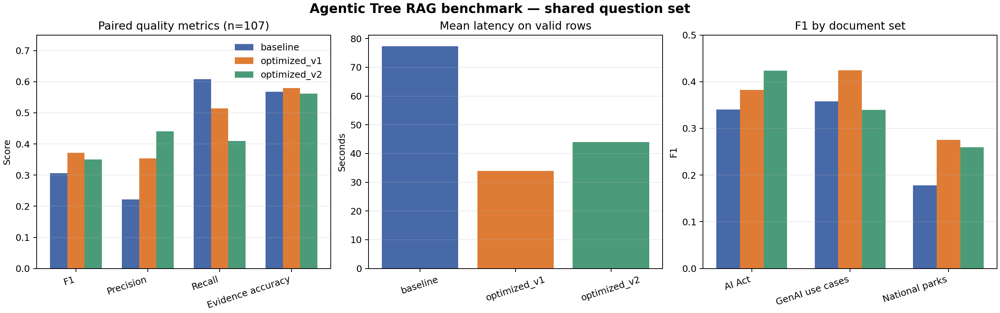

# Experiments

## Evaluation sets

Three long-document QA sets were used:

| Set | Shared questions | Main challenge |
|---|---:|---|
| EU AI Act | 40 | Exact facts, counts, and cross-article lookup |
| Generative AI use cases | 40 | Section retrieval and comparison |
| European national parks | 27 | Exhaustive listing, filtering, and sorting |

The common set contains 107 questions: 30 single-fact (A), 30 enumeration (B), 27 summary/comparison (C), and 20 cross-section (D).

## Paired comparison

The original runs contain different row counts. All headline numbers below are recalculated on the 107 `(dataset, question_id, category)` keys shared by baseline, optimized v1, and optimized v2.

| Run | F1 | Precision | Recall | Evidence accuracy | Mean latency |
|---|---:|---:|---:|---:|---:|
| Baseline | 0.306 | 0.222 | **0.609** | 0.567 | 77.4 s |
| Optimized v1 | **0.371** | 0.354 | 0.514 | **0.579** | **33.9 s** |
| Optimized v2 | 0.351 | **0.440** | 0.409 | 0.562 | 44.0 s |



Optimized v1 has the strongest overall F1 and the lowest mean latency. Optimized v2 shifts toward precision: it has the highest precision and the best F1 on the AI Act set, but lower recall. Evidence accuracy remains close across the three runs, so the main recorded change is the precision/recall and latency trade-off rather than a large grounding gain.

## F1 by document set

| Document set | Baseline | Optimized v1 | Optimized v2 |
|---|---:|---:|---:|
| EU AI Act | 0.340 | 0.383 | **0.424** |
| Generative AI use cases | 0.358 | **0.424** | 0.339 |
| European national parks | 0.178 | **0.276** | 0.259 |

National parks remains the hardest set. It requires complete enumeration and exact attribute extraction across many repeated units—the failure mode that motivated `scan_all` and structure-aware traversal.

## Valid-row counts

F1, precision, and recall are available for all 107 shared questions. Some runtime rows ended with `ERROR` and therefore do not have latency or evidence values:

| Run | Latency valid n | Evidence valid n | LLM-judge valid n |
|---|---:|---:|---:|
| Baseline | 104 | 104 | 0 |
| Optimized v1 | 107 | 107 | 107 |
| Optimized v2 | 105 | 105 | 107 |

The baseline did not record LLM-judge scores, so LLM-score comparisons are not used in the headline table.

## Run labels

`optimized_v1` and `optimized_v2` are retained as run identifiers. The files do not contain a one-variable experiment manifest, so the differences should be read as comparisons between complete recorded configurations, not as proof that one isolated change caused the result.

Short pilot files with 3 and 15 questions, a duplicate baseline export, and a three-question verification failure study are not included in the paired headline comparison.

## Rebuild

```bash
python tools/build_benchmark_report.py
```

This produces:

- `benchmarks/results/paired_summary.json`
- `benchmarks/results/paired_summary.csv`
- `benchmarks/results/paired_by_dataset.csv`
- `assets/benchmark-comparison.png`
